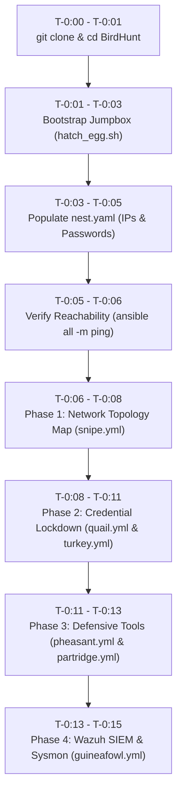

# BirdHunt - Collegiate Cyber Defense Competition (CCDC) Operational Guide

> **COMPETITION DIRECTIVE**: You have **NO** access to the competition environment prior to the match. The only asset you bring into the competition is this uploaded repository.
> 
> This guide is an exact, minute-by-minute operational runbook starting at **Minute 0:00** when you first sit at the jumpbox keyboard and clone this repository.

---

## Pre-Competition Checklist (Do This BEFORE Uploading the Repo)

This repository has already been pre-packaged to be **100% self-contained and air-gapped**:
- **Offline Python Wheels**: Pre-downloaded in `./wheelhouse/` (`pywinrm`, `requests-ntlm`, `passlib`, `cryptography`, etc.).
- **Ansible Collections**: Pre-installed in `./collections/` (`ansible.windows`, `community.windows`, `community.general`).
- **Offline Agent & Tool Binaries**: Pre-staged in `./playbooks/files/` (Wazuh installer, Linux `.deb`/`.rpm`, Windows `.msi`, `Sysmon64.exe`, `sysmonconfig.xml`, `SysinternalsSuite`, `MBSetup.exe`, `linpeas.sh`).
- **GitHub File-Size Compliance**: Large binaries (`MBSetup.exe` and `SysinternalsSuite.zip`) are pre-split into `< 80 MB` chunks (`.part_*`) so `git push` will **never** be rejected by GitHub's 100MB file limit. `./hatch_egg.sh` automatically reassembles them upon clone.

**All you need to do before the match is commit and push:**
```bash
cd BirdHunt
git add -A
git commit -m "BirdHunt 100% Self-Contained Offline Competition Repo"
git push origin main
```

---

## Obfuscation & File Taxonomy Reference

All scripts and playbooks use a bird/hunting taxonomy to prevent immediate recognition if exposed:

| Component | Obfuscated File | Operational Purpose |
| :--- | :--- | :--- |
| **Inventory** | **[`nest.yaml`](file:///Users/matt/Desktop/BirdHunt/nest.yaml)** | Master target host & credential inventory ("The Nest") |
| **Master Orchestrator** | **[`playbooks/birdshot.yml`](file:///Users/matt/Desktop/BirdHunt/playbooks/birdshot.yml)** | "Bird Shot" master playbook (executes all phases) |
| **Network Discovery** | **[`playbooks/snipe.yml`](file:///Users/matt/Desktop/BirdHunt/playbooks/snipe.yml)** | [Snipe] Port/listener enumeration & connection graphing |
| **Linux Lockdown** | **[`playbooks/quail.yml`](file:///Users/matt/Desktop/BirdHunt/playbooks/quail.yml)** | [Quail] Unshadow passwords, kill UID 0, rotate credentials |
| **Windows Lockdown** | **[`playbooks/turkey.yml`](file:///Users/matt/Desktop/BirdHunt/playbooks/turkey.yml)** | [Turkey] Deterministic Windows local account rotation (DC-safe) |
| **Windows Tooling** | **[`playbooks/partridge.yml`](file:///Users/matt/Desktop/BirdHunt/playbooks/partridge.yml)** | [Partridge] Deploy Sysinternals Suite & Malwarebytes |
| **Linux Tooling** | **[`playbooks/pheasant.yml`](file:///Users/matt/Desktop/BirdHunt/playbooks/pheasant.yml)** | [Pheasant] Deploy IR tools, `triage.sh`, and `check_integrity.sh` |
| **SIEM & Telemetry** | **[`playbooks/guineafowl.yml`](file:///Users/matt/Desktop/BirdHunt/playbooks/guineafowl.yml)** | [Guineafowl] Air-gapped Wazuh Manager, Agent & Sysmon |
| **Jumpbox Setup** | **[`hatch_egg.sh`](file:///Users/matt/Desktop/BirdHunt/hatch_egg.sh)** | [Hatch Egg] Jumpbox dependency installer |
| **Container Runner** | **[`crack_egg.sh`](file:///Users/matt/Desktop/BirdHunt/crack_egg.sh)** | [Crack Egg] Runs playbooks inside pre-built container |
| **Artifact Stager** | **[`scripts/lay_egg.sh`](file:///Users/matt/Desktop/BirdHunt/scripts/lay_egg.sh)** | [Lay Egg] Downloads all offline installers into `playbooks/files/` |
| **User Audit Tool** | **[`scripts/egg_candler.sh`](file:///Users/matt/Desktop/BirdHunt/scripts/egg_candler.sh)** | [Egg Candler] Fast user audit launcher |
| **Legacy Python Audit** | **[`scripts/candled_egg.py`](file:///Users/matt/Desktop/BirdHunt/scripts/candled_egg.py)** | [Candled Egg] Original Paramiko Python audit script |

---

## Minute-by-Minute Competition Runbook (T-0:00 to T-0:15)



---

### Minute 0:00 – 0:01 | Drop In & Clone
Sit down at the Jumpbox terminal, open your shell, and pull down your pre-approved repository:
```bash
git clone <YOUR_COMPETITION_REPO_URL> BirdHunt
cd BirdHunt
chmod +x hatch_egg.sh bake_egg.sh crack_egg.sh scripts/*.sh scripts/*.py
```

---

### Minute 0:01 – 0:03 | Bootstrap Jumpbox Dependencies
You are on a fresh Jumpbox VM provided by Black Team. Initialize dependencies immediately:

#### Path A: Standard Bare-Metal Jumpbox
```bash
sudo ./hatch_egg.sh
```
*Installs Ansible, Python 3, PyWinRM, Graphviz, Passlib, and installs the required Windows Galaxy collections.*

#### Path B: Containerized Execution (If Podman/Docker is Available & `birdhunt-ee.tar` was pre-staged)
```bash
# If container runtime is present, you don't even need to run hatch_egg.sh:
./crack_egg.sh all -m ping
```

---

### Minute 0:03 – 0:05 | Populate the "Nest" (`nest.yaml`)
White Team will hand you your team packet containing assigned IP subnets, hostnames, and initial default passwords.

Open **[`nest.yaml`](file:///Users/matt/Desktop/BirdHunt/nest.yaml)**:
```bash
nano nest.yaml
# or: vim nest.yaml
```

1. **Subnet Rapid Replacement**:
   If the sample subnet is `192.168.220.x` and your assigned competition subnet is `10.10.5.x`, update it instantly:
   ```bash
   sed -i 's/192.168.220./10.10.5./g' nest.yaml
   ```
2. **Update Initial Passwords**:
   In `nest.yaml`, verify and set the default passwords provided in the team packet:
   - Under `windows: vars:`: update `ansible_password: "InitialWindowsPass123!"`
   - Under `linux: vars:`: update `ansible_password: "InitialLinuxPass123!"`
   - Under `jumpbox: hosts: localhost:`: update `ansible_become_password: "JumpboxSudoPass!"`
3. **Whitelist Scored Accounts**:
   Check your inject packet for scored service accounts (e.g. `serveradmin`, `scoreuser`, `httpcheck`). Add them to the host's `whitelist: ['root', 'serveradmin']` so automated rotation or cleanup does not lock out scoring checks.

---

### Minute 0:05 – 0:06 | The "Ping Gate" (Connection Verification)
Verify you have working network and credential access to every box:
```bash
ansible all -m ping
```
*(If using the container: `./crack_egg.sh all -m ping`)*

- **Green (`SUCCESS`)**: Machine is connected and ready.
- **Red (`UNREACHABLE / AUTH FAILED`)**:
  - If a specific box fails, test it individually: `ansible <hostname> -m ping -vvv`
  - Verify IP and credentials in `nest.yaml`.
  - **COMPETITION RULE**: Do not let 1 failing host stall you. Use `--limit` to exclude stubborn hosts and keep moving forward with the rest of the fleet!

---

### Minute 0:06 – 0:08 | Phase 1: Network Topology & Listener Discovery (`snipe.yml`)
Before changing configurations, capture the initial state of the network:
```bash
ansible-playbook playbooks/snipe.yml
```
*(Container: `./crack_egg.sh playbooks/snipe.yml`)*

**What this does**:
- Linux nodes dump `ss -tulnp` (listeners) and `ss -tn state established` (active connections).
- Windows nodes dump `Get-NetTCPConnection` and `Get-NetUDPEndpoint`.
- Jumpbox compiles and renders `network-maps/network-<timestamp>.png` and `.json`.

**Immediate Operator Action**:
Open the generated image:
```bash
xdg-open network-maps/network-*.png 2>/dev/null || open network-maps/network-*.png
```
- **Inspect listeners**: Spot non-standard ports (e.g. 4444, 1337, 8888, 31337) indicating pre-installed backdoors or extra web shells.
- **Inspect established connections**: Look for active outbound sessions to unknown foreign IPs (Red Team C2 beacons!).

---

### Minute 0:08 – 0:11 | Phase 2: Credential Lockdown & Backdoor Eradication
Red Team will attempt to log in using default credentials and pre-planted backdoors within minutes. Shut the door immediately.

Choose a secret team password seed for this match:
```bash
SEED="CCDC2026_TeamSuperSecret!"
```

#### Step 2A: Linux Lockdown ([`quail.yml`](file:///Users/matt/Desktop/BirdHunt/playbooks/quail.yml))
```bash
ansible-playbook playbooks/quail.yml -e "seed_val=${SEED}"
```
- **Automatic Backup**: Backs up `/etc/passwd` and `/etc/shadow` to `/root/birdhunt_backups/`.
- **Unshadows Passwords**: Finds accounts with plaintext/hashes directly in `/etc/passwd`, relocates them to `/etc/shadow`, and sets passwd field 2 to `x`.
- **Kills Rogue UID 0 Backdoors**: Immediately alerts on any non-root user with UID 0 (e.g. `toor`, `guest`, `admin`) and locks them (`passwd -l <user>`).
- **Purges Blacklist Users**: Removes unauthorized backdoor users specified in `nest.yaml`.
- **Deterministic Password Rotation**: Computes and applies `((username + hostname + seed) | sha256)` across all active users.
- **Session Preservation**: Automatically updates `ansible_password` in memory so subsequent tasks remain authenticated.

#### Step 2B: Windows Lockdown ([`turkey.yml`](file:///Users/matt/Desktop/BirdHunt/playbooks/turkey.yml))
```bash
ansible-playbook playbooks/turkey.yml -e "seed_val=${SEED}"
```
- **Domain Controller Safeguard**: Automatically queries `Win32_ComputerSystem.DomainRole`. If the host is a Domain Controller (Role 4 or 5), it **aborts execution on that host** to prevent breaking Active Directory replication or domain-wide lockouts.
- **Disables Built-in Guest**: Shuts down the default `Guest` account.
- **Rotates Discovered Local Users**: Enumerates enabled non-system accounts and updates passwords using deterministic SHA-256 + complexity suffix (`B@LL5`).
- **Rotates Local Administrator**: Sets the new Administrator password and updates `ansible_password` in memory.

---

### Minute 0:11 – 0:13 | Phase 3: Defensive Tooling Deployment

#### Step 3A: Linux Defensive Tools ([`pheasant.yml`](file:///Users/matt/Desktop/BirdHunt/playbooks/pheasant.yml))
```bash
ansible-playbook playbooks/pheasant.yml
```
- Installs `lsof`, `tcpdump`, `htop`, `psmisc`, `strace`, `auditd`, `debsums`, `tmux`, and `net-tools`.
- Starts and enables the `auditd` system audit daemon.
- Deploys **`/opt/birdhunt/tools/triage.sh`**: Instantly dumps listening sockets, active connections, deleted running binaries (`/proc/*/exe -> (deleted)`), SUID binaries, cron jobs, and SSH authorized keys.
- Deploys **`/opt/birdhunt/tools/check_integrity.sh`**: Runs `debsums -c` or `rpm -Va` to alert if Red Team replaced system binaries (`ls`, `ps`, `sshd`, `netstat`).
- Adds `/opt/birdhunt/tools` to global `$PATH`.

#### Step 3B: Windows Defensive Tools ([`partridge.yml`](file:///Users/matt/Desktop/BirdHunt/playbooks/partridge.yml))
```bash
ansible-playbook playbooks/partridge.yml
```
- Extracts Sysinternals Suite to `C:\Tools\Sysinternals` and adds it to the machine system `PATH`.
- Copies the Malwarebytes offline installer to `C:\Temp\Installers\MBSetup.exe`.

---

### Minute 0:13 – 0:15 | Phase 4: Wazuh SIEM & Sysmon Deployment ([`guineafowl.yml`](file:///Users/matt/Desktop/BirdHunt/playbooks/guineafowl.yml))
Gain immediate real-time detection and file integrity monitoring (FIM) across all hosts:
```bash
ansible-playbook playbooks/guineafowl.yml
```
- **Play 1**: Deploys Wazuh Manager, Indexer, and Dashboard locally on the Jumpbox.
- **Play 2**: Verifies offline agent artifacts in `playbooks/files/`.
- **Play 3 (Linux)**: Copies `.deb`/`.rpm` agent, installs locally without internet, points agent to Jumpbox IP, and configures real-time FIM for `/etc`, `/usr/bin`, `/root`, and `/var/www`.
- **Play 4 (Windows)**: Installs Sysmon64 with modular configuration (1 GB event log buffer), installs Wazuh MSI agent silently, and enables log ingestion for Sysmon and Windows Security event channels.
- **Credentials**: Wazuh Dashboard username (`admin`) and generated password are saved to `wazuh_credentials.txt` in the BirdHunt root directory.

---

## The All-in-One Fast-Track Alternative: "Bird Shot"

If you want to execute all 4 phases in a single pipeline:

```bash
ansible-playbook playbooks/birdshot.yml -e "seed_val=CCDC2026MasterSeed!"
```
*(Or via container: `./crack_egg.sh playbooks/birdshot.yml -e "seed_val=CCDC2026MasterSeed!"`)*

You can also target specific phases using tags:
```bash
ansible-playbook playbooks/birdshot.yml --tags map
ansible-playbook playbooks/birdshot.yml --tags passwords -e "seed_val=CCDC2026MasterSeed!"
ansible-playbook playbooks/birdshot.yml --tags tools
ansible-playbook playbooks/birdshot.yml --tags wazuh
```

---

## Competition Troubleshooting & Contingencies

### 1. How to Recalculate a User's Password Manually
If you need to log into a host via console (vSphere/Proxmox) after running password rotation:
- **Windows**:
  Run in bash/python:
  ```bash
  python3 -c "import hashlib; print(hashlib.sha256(('administrator' + 'viking' + 'YOUR_SEED').encode()).hexdigest() + 'B@LL5')"
  ```
- **Linux**:
  Run in bash/python:
  ```bash
  python3 -c "import hashlib; print(hashlib.sha256(('root' + 'brassknuckels' + 'YOUR_SEED').encode()).hexdigest())"
  ```

### 2. Emergency Linux Rollback
If a credential rotation locks out a scored service or breaks an SSH inject:
```bash
sudo cp /root/birdhunt_backups/passwd.*.bak /etc/passwd
sudo cp /root/birdhunt_backups/shadow.*.bak /etc/shadow
```

### 3. WinRM Connection Refused on Windows
If Windows fails on ping or playbook execution:
- Run locally on the Windows target VM console in PowerShell (as Administrator):
  ```powershell
  winrm quickconfig -q
  Set-Item -Path WSMan:\localhost\Service\Auth\Negotiate -Value $true
  Set-Item -Path WSMan:\localhost\Service\AllowUnencrypted -Value $true
  Restart-Service WinRM
  ```

### 4. Jumpbox Host Key Verification Hangs
If SSH prompts for confirmation (`The authenticity of host... can't be established`):
- `ansible.cfg` has `host_key_checking = False` pre-configured. If running ad-hoc `ssh`, use:
  ```bash
  ssh -o StrictHostKeyChecking=no -o UserKnownHostsFile=/dev/null user@host
  ```
